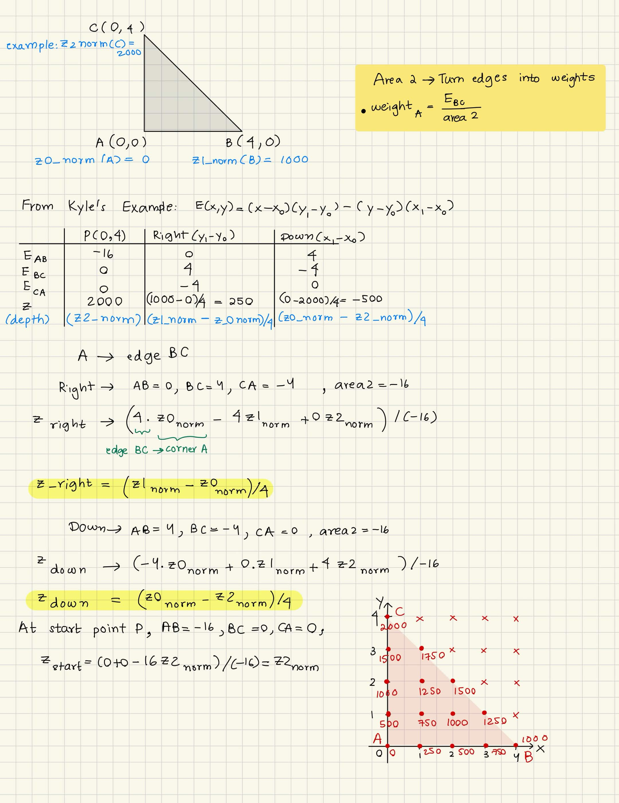
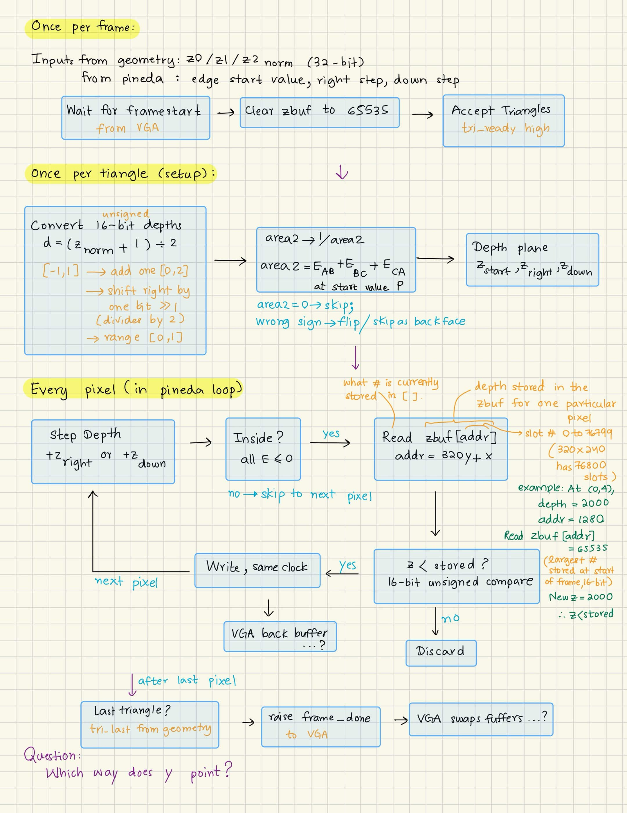
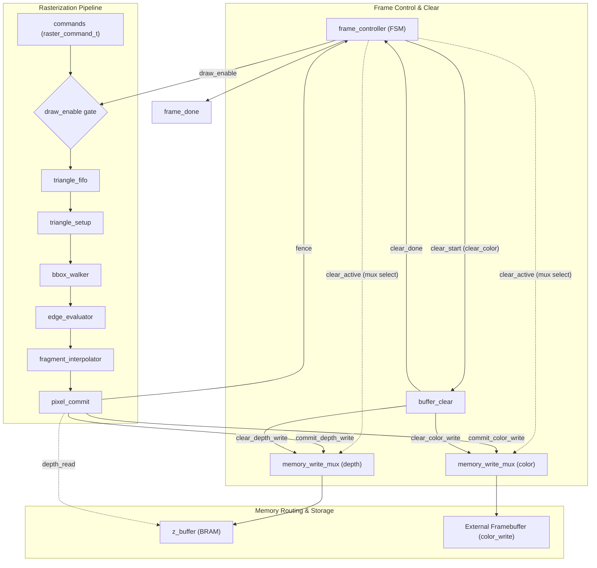

# Rasterization Group Meeting 3

**Date & Time:** 2026-11-10 | 12:00 – 13:15 (PST) 
**Location / Link:** ENGR 370
**Facilitator:** Kyle
**Note Taker:** Kyle
**Meeting Status:** Completed on November 10, 2026.

---

### Attendees
* **Present:** Kyle, Wint, Rayland
* **Absent / Excused:** Sean

---

### Agenda & Objectives
1. Wint's research: Z-buffer integration and barycentric weights.
2. Quick tour of the new packages (`gpu_pkg`, `rasterizer_pkg`, `geometry_pkg`) and interfaces from PR #55.
3. RTL pipeline scaffolding walkthrough and module assignments.
4. Open design questions and next sprint tasks.

---

### Discussion Points

#### 1. Wint's Z-Buffer & Barycentric Weights Research

Wint looked into integrating depth buffering with the Pineda rasterizer ([issue #25](https://github.com/cdi-sjsu/tiny-fixed-function-gpu/issues/25)).

##### Barycentric Weights from Edge Functions

* **Key Takeaway:** Edge values $e_0, e_1, e_2$ are proportional to the signed sub-areas of the triangle.
* **Weights:** $\lambda_i = e_i / \text{total\_area}$, where the denominator is the signed area of the whole triangle.
* To keep the pixel pipeline fast and avoid a divider per pixel, we precompute $1 / \text{area}$ once during `triangle_setup`.
* **Interpolation:**
  * Affine depth: $z = \lambda_0 z_0 + \lambda_1 z_1 + \lambda_2 z_2$
  * Affine Gouraud: Same linear interpolation for R, G, and B.
  * *Question for the team:* Affine Gouraud (screen-space linear) doesn't account for perspective foreshortening, but it completely avoids per-pixel division. Is this good enough for our first milestone demo?

##### Z-Buffer Pipeline Flow

* Depth test rule: Smaller $z$ is closer. A pixel passes if $z_{\text{new}} < z_{\text{stored}}$.
* `pixel_commit` handles the read-modify-write: reads depth from BRAM, tests it, and writes updated depth + color on pass.
* `buffer_clear` resets depth to `0xFFFF` (`DEPTH_CLEAR`) and fills color with the background before drawing starts.

---

#### 2. Package & Interface Cleanup (PR #55)

PR #55 split the monolithic `gpu_pkg` into cleaner, dedicated packages and replaced loose wiring with SystemVerilog interfaces:

* **`gpu_pkg` (Inter-Team Interface):**
  * Shared between Geometry, Rasterizer, and Framebuffer/VGA.
  * Fixed-point screen coordinates: 20-bit signed Q16.4 (`screen_coord_t`).
  * Formats: 16-bit depth (`depth_t`), 12-bit color (`rgb444_t`), and `raster_command_t` packets (triangle data + `end_frame` marker).
  * Resolution constants for 640 × 480 (307,200 pixels).
* **`rasterizer_pkg` (Internal Pipeline Types):**
  * Wide fixed-point types for internal math: 42-bit edge accumulators (`edge_value_t`) and 48-bit Q32.16 attribute accumulators (`attribute_t`).
  * Pipeline data structures: `triangle_setup_t`, `raster_sample_t`, and final clamped `fragment_t`.
* **`geometry_pkg` (Geometry Team Types):**
  * 32-bit Q16.16 types (`geometry_scalar_t`), 4D vectors (`xyzw_vector_t`), and $4 \times 4$ transformation matrices.
* **Standardized SV Interfaces:**
  * `stream_if`: Ready/valid handshake channel for streaming pipeline stages.
  * `memory_read_if` & `memory_write_if`: Decoupled request/response handshakes for BRAM and external framebuffer access.

---

#### 3. Pipeline Architecture & RTL Scaffolding

All modules for `rasterizer_top` have been scaffolded with ports and stubs.

##### Top-Level Architecture

##### Module Status & Assignments

* [`frame_controller`](../../../rtl/rasterizer/frame_controller.sv) — *Stubbed* (**Owner: Kyle**)
  * Main FSM: IDLE → CLEAR → DRAW → DRAIN → DONE. Gates incoming commands, starts buffer clearing, and asserts `frame_done` once the fence returns.
* `triangle_fifo` (`rtl/rasterizer/triangle_fifo.sv`) — *To be added* (**Owner: Sean**)
  * Input command FIFO (`stream_if` consumer/producer + `busy`) instantiated in `rasterizer_top`, replacing the generic `sync_fifo` stub.
* [`triangle_setup`](../../../rtl/rasterizer/triangle_setup.sv) — *Stubbed* (**Owner: TBD**)
  * Bounding box calculation, screen clamping, winding check, and initial edge/attribute gradients at the starting pixel.
* [`bbox_walker`](../../../rtl/rasterizer/bbox_walker.sv) — *Stubbed* (**Owners: Wint & Rayland**)
  * Traverses bounding box scanlines and steps edge, depth, and color accumulators.
* [`edge_evaluator`](../../../rtl/rasterizer/edge_evaluator.sv) — *Stubbed* (**Owners: Wint & Rayland**)
  * Tests sample coverage against all three edges, applies top-left tie-breaking rules, discards outside samples, and passes end-of-frame markers.
* [`fragment_interpolator`](../../../rtl/rasterizer/fragment_interpolator.sv) — *Stubbed* (**Owners: Wint & Rayland**)
  * Rounds and clamps 48-bit depth/color attributes into 16-bit depth and 12-bit RGB444 fragments.
* [`pixel_commit`](../../../rtl/rasterizer/pixel_commit.sv) — *Stubbed* (**Owners: Wint & Rayland**)
  * Read-modify-write depth test, writeback to depth/color, and fence token generation for frame completion.
* [`buffer_clear`](../../../rtl/rasterizer/buffer_clear.sv) — *Stubbed* (**Owner: TBD**)
  * Increments through all 307,200 pixel addresses writing clear depth and background color.
* [`z_buffer`](../../../rtl/rasterizer/z_buffer.sv) — *Stubbed* (**Owner: TBD**)
  * BRAM wrapper exposing `memory_read_if` and `memory_write_if`.
* [`memory_write_mux`](../../../rtl/common/memory_write_mux.sv) — **Implemented**
  * Arbitrates write access between `buffer_clear` and `pixel_commit`.

---

#### 4. Open Design Questions

* **BRAM Capacity on Arty A7-100T:**
  * 640 × 480 × 16-bit depth = ~4.9 Mb.
  * The A7-100T has 4.86 Mb of block RAM. If we keep native 640 × 480 with both color and depth, double check if we need 320 × 240 scaled rendering or if we fit tightly on-chip.
* **Affine vs. Perspective-Correct:**
  * Affine interpolation is simple and keeps our pipeline adder-only. Are we all agreed on sticking with affine for demo 1?
* **Winding Normalization:**
  * When flipping winding order in setup, remember to swap vertex colors/depths alongside coordinates.
* **Framebuffer Address Calculation:**
  * Address formula is $y \times 640 + x$. We can implement this with shift-and-add: $(y \ll 9) + (y \ll 7) + x$ (512 + 128 = 640) to save DSP slices.

---

### Key Decisions Made

* **Initial module ownership:**
  * **Kyle:** `frame_controller` (main frame-control FSM).
  * **Wint & Rayland:** `bbox_walker` and downstream pipeline stages (`bbox_walker`, `edge_evaluator`, `fragment_interpolator`, `pixel_commit`).
  * **Sean:** `triangle_fifo` queue (assigned while absent; confirm with Sean).
  * **Undecided:** Ownership of `triangle_setup`, `buffer_clear`, and `z_buffer` remains TBD.
  * Each module owner also writes the corresponding Cocotb testbench in `tb/rasterizer/`.
* **Queue consolidation:** Use `triangle_fifo` directly in `rtl/rasterizer/` instead of maintaining a separate generic `sync_fifo` stub in `rtl/common/`.
* **Open design questions:** Resolution/BRAM sizing (640 × 480 vs. 320 × 240 on Arty A7-100T) and affine Gouraud confirmation for Demo 1 remain open for follow-up.

---

### Action Items & Assignments

Each module task includes its corresponding Cocotb testbench in `tb/rasterizer/`.

| Task | Assignee | Due Date | Status |
| :--- | :--- | :--- | :--- |
| Present Z-buffer research & barycentric math | Wint | 2026-11-10 | Done |
| `frame_controller` FSM implementation | Kyle | TBD | Assigned |
| `triangle_fifo` queue (replace generic `sync_fifo`) | Sean | TBD | Assigned |
| `bbox_walker` & accumulator stepping | Wint & Rayland | TBD | Assigned |
| `edge_evaluator` coverage & top-left rules | Wint & Rayland | TBD | Assigned |
| `fragment_interpolator` rounding & clamping | Wint & Rayland | TBD | Assigned |
| `pixel_commit` & depth-test logic | Wint & Rayland | TBD | Assigned |
| `triangle_setup` implementation | TBD | TBD | Unassigned |
| `buffer_clear` implementation | TBD | TBD | Unassigned |
| `z_buffer` BRAM wrapper | TBD | TBD | Unassigned |

---

### Next Steps & Follow-Up
* **Next Meeting:** TBD (tentatively 2026-11-17 | 12:00 PST)
* Review and commit pending `edam.yml` updates adding new modules to the build.
